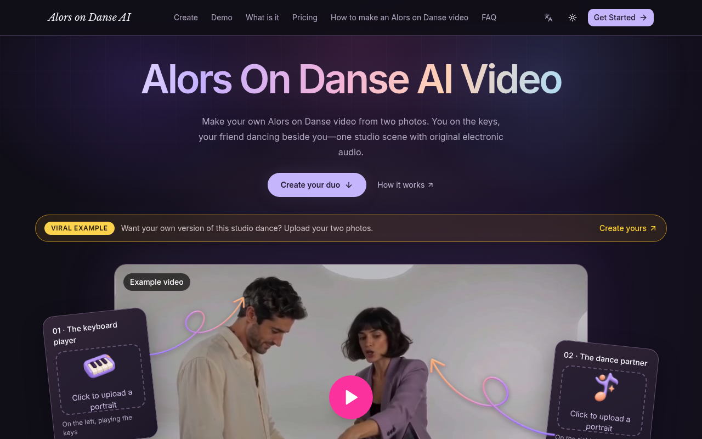
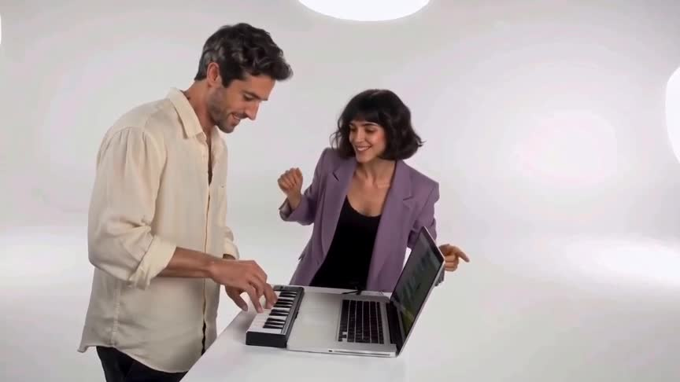
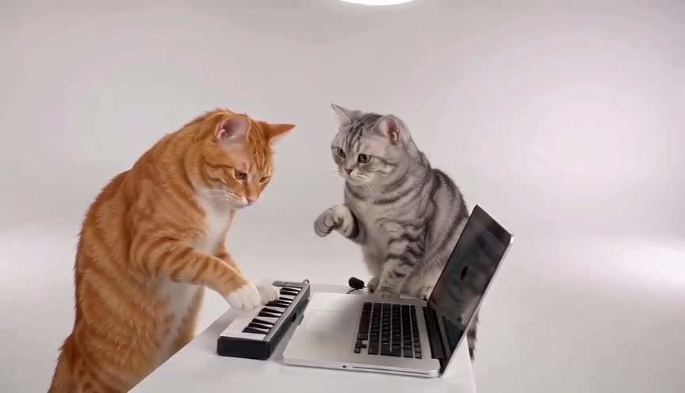

# Alors on Danse AI

  

  <strong>两张照片 → 白色摄影棚迷你键盘双人短片</strong> 
  付费成片约 15s · 竖屏友好 · 游客可付 
  起价 <b>$8.88</b> · 无订阅、无需注册

  
  

---

## 截图

  
  

---

## 怎么用

1. 打开 [tryalorsondanse.video](https://tryalorsondanse.video)
2. 上传 Photo 1（键盘手，左）与 Photo 2（舞伴，右）——须为不同的人
3. 选画幅（16:9 贴近横屏翻拍；9:16 适合 Shorts）→ Create
4. Stripe：Single **$8.88** / 3-pack **$16.99** / 10-pack **$39.90**（约 **15 秒**）

---

## 产品要点

- 角色分工清晰：左弹键盘、右带气氛 / 扑镜
- 视觉重制公开梗格式，**不是**原片换脸
- 付费成片约 **15 秒**；含原创 AI 电子音乐（非商业原曲）
- 独立粉丝工具，与原曲艺人及厂牌无关

---

## 定价

| 套餐 | 价格 | 积分 |
|---|---|---|
| Single | $8.88 | 500 ≈ 1×720p |
| 3-pack | $16.99 | 1500 ≈ 3×720p |
| 10-pack | $39.90 | 5000 ≈ 10×720p |

一次性积分包，无订阅。英文简介：*Two photos → white-studio mini-keyboard duo short → MP4 with original AI electronic track.*

---

## Links

- 官网：https://tryalorsondanse.video
- GitHub Pages：https://xianyu110.github.io/alors-on-danse/
- 仓库：https://github.com/xianyu110/alors-on-danse

---

## License

Demo media for product showcase. Site © Maynor / xianyu110. Please only upload photos you own or have permission to use. Fan tool — unaffiliated with original artists, labels, or rights holders.
